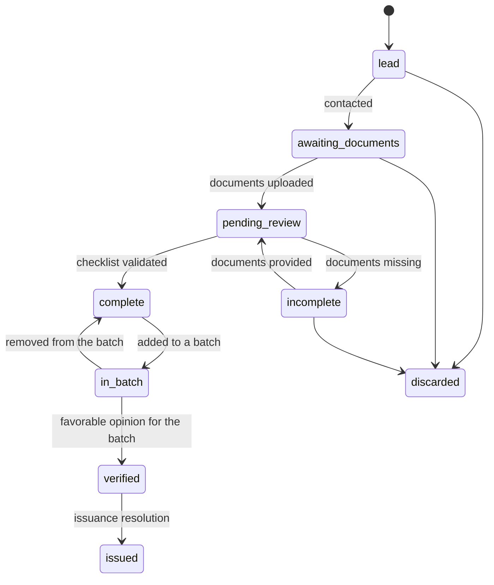
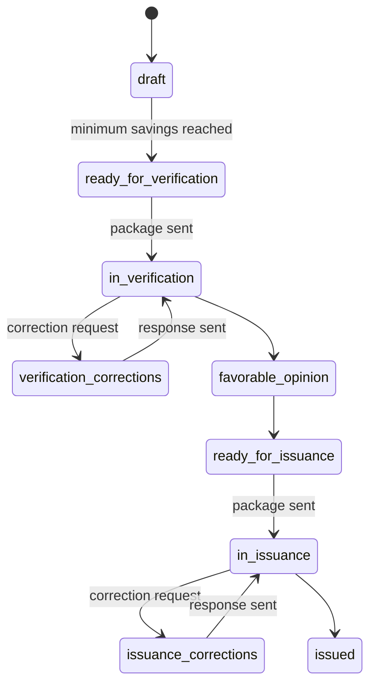
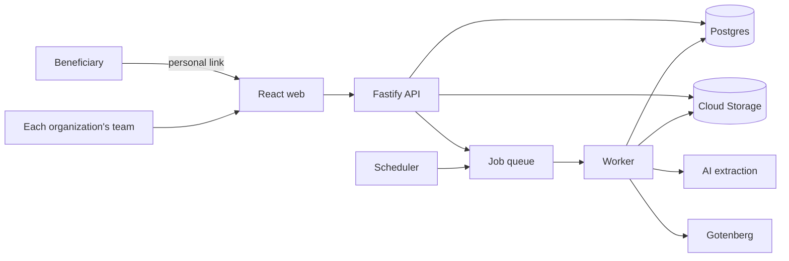

# Certia — Project

## 1. Context

**Energy Savings Certificates (CAE, *Certificados de Ahorro Energético*)** are regulated in Spain by Royal Decree 36/2023. Each CAE certifies 1 kWh of final energy saved by an energy efficiency action. Companies with energy savings obligations buy them, and whoever generates the savings (or an intermediary that aggregates them) sells them.

**Certia is a product for the companies that manage CAE cases**: facilitators, delegated parties and installers that aggregate efficiency actions and take them through to certificate issuance. The official catalog has 70–80 standardised measures (*fichas*), each with its own fields, formulas and documents, and it changes with regulation.

The workflow is common across the sector:

1. **Lead capture**: forms and referral channels → lead → follow-up → contact.
2. **Document review**: the beneficiary provides documents; the team reviews them until the **case is complete**.
3. **Batches**: complete cases from the same region and year are grouped until they exceed the required minimum savings.
4. **Verification**: the batch is sent to an ENAC-accredited verifier; correction requests until a **favorable opinion** is issued.
5. **Issuance**: the batch is sent to the regional authority; correction requests until the **issuance resolution**.
6. **Sale, invoicing and payment** to beneficiaries.

**Product sources.** Certia is built from public regulation and documentation (Royal Decree 36/2023, the Ministry's catalog of measures, regional procedures), general sector knowledge, and what design partners provide with their written permission. Never from third parties' confidential information.

## 2. Problem

What is common in the sector:

- Information lives in spreadsheets, shared folders and standalone tools, connected by hand or with fragile scripts.
- The team writes the same data in several places: status, priorities, batch tracking, daily follow-up.
- Every regulatory change to a measure means redoing calculations, templates and checks by hand.
- Templates (savings assignment agreement, responsible declaration) are edited by hand for every variant.
- Beneficiaries' sensitive data (ID numbers, bank accounts, addresses) circulates without adequate protection.
- Custom-built tools depend on a single person and nobody maintains them once that person leaves.

## 3. Product principles

1. **One tool** for the whole workflow, from lead capture to issuance.
2. **Data protection** by design: encryption, role-based permissions, auditing and data kept in the EU.
3. **Robustness**: every change is recorded and measures are tested before they are published.
4. **Write once, in one place.**
5. **Measures as configuration**: a new measure or a regulatory change does not require programming.
6. **Multi-company**: each organization only sees its own data and configures its own roles and templates.

MVP goal: **a company in the sector can manage its cases for one measure end to end in Certia, without spreadsheets in day-to-day operations**, validated with 2–3 design partners.

## 4. Scope

### In the MVP

- One complete initial measure (electric vehicle, to be confirmed by the interviews), with its previous and current version and a comparator.
- Several organizations isolated from each other; organizations are set up by the Certia team.
- Leads, beneficiaries and cases with a status workflow.
- Document upload portal for beneficiaries.
- Document normalization (PDF conversion, renaming, compression).
- AI data extraction with human review.
- Savings calculation according to the measure.
- Generation of the savings assignment agreement and responsible declaration with optional clauses, using each organization's own templates.
- Batches: automatic proposal, verification and issuance packages.
- Correction requests as tasks.
- Traffic light of stalled cases and batches, KPIs per person.
- Roles, auditing and encryption of sensitive data.
- Case import from spreadsheets.

### Out of the MVP (later phases)

- More measures, prioritized by customer demand.
- Self-service organization sign-up and subscription billing.
- Payments to beneficiaries and SEPA remittances.
- CAE invoicing and accounting or ERP integration.
- Visual measure editor.
- Integrated WhatsApp and calls.
- Verifier portal.
- Automatic reminders to verifiers (the MVP already detects stalled items).

## 5. Users and roles

Within each customer organization:

| Role | What they do |
|---|---|
| **Admin** | Organization settings, users, templates, full access |
| **Director** | Dashboards, KPIs and read access to everything |
| **Case manager** | Relationship with the beneficiary: leads, documents, review, beneficiary corrections |
| **Verifier** | Batches, verifiers, regional authority, issuance |
| **Viewer** | Read-only access |
| **Beneficiary** | External access, only to their upload portal through a personal link |

A user can have several roles. Bank details and identity documents are only visible to the roles that need them. The Certia team manages the catalog of measures shared by all organizations.

## 6. Workflows

### Case

### Batch

The conditions for each transition (for example, "checklist validated") are defined in the measure and checked by the workflow engine.

## 7. Architecture

### Decisions

| # | Decision | Reason |
|---|---|---|
| D1 | **Modular monolith** in Node.js and TypeScript, one image with `api` and `worker` modes | Fast development and simple maintenance, without the complexity of microservices |
| D2 | **Measures as versioned configuration** (YAML in the repository for the MVP) | Scale to any kind of efficiency action without touching the engine |
| D3 | **Published measure versions are immutable**; each case is pinned to a version | A regulatory change does not break existing cases, and it enables the comparator |
| D4 | **Postgres as the single source of truth**; measure-specific data in validated JSONB | Removes spreadsheets as intermediaries |
| D5 | **Event table** for every change | History, auditing, traffic light and KPIs without double entry |
| D6 | **`core` without infrastructure dependencies**; integrations behind `adapters` | Testable business logic and portability between providers |
| D7 | **Google Cloud** (Cloud Run, Cloud SQL, Cloud Storage) in Madrid, domain **certia-es.com** | Low-cost managed services and customer data in Spain |
| D8 | **Sign-in with corporate accounts** (Google and, later, Microsoft) restricted to each organization's domain | Each customer manages joiners and leavers, no passwords of our own |
| D9 | **Application-level encryption of ID numbers and IBANs** with the key in Cloud KMS | A copy of the database does not expose that data |
| D10 | **`organization_id` on every table** and isolation checked on every query | Several organizations on the same installation without any of them seeing another's data |
| D11 | **Everything in English**: code, data, docs and UI | One language for the team and the codebase; Spanish UI text will come from i18n |

### Components

## 8. Data model (summary)

| Table | Main content |
|---|---|
| `organizations` | Customer company |
| `users`, `user_roles` | Users and roles |
| `contacts` | Beneficiaries (sensitive data encrypted) |
| `leads` | Source, channel, contact status |
| `measure_versions` | Code, version, validity, hash of the definition |
| `cases` | Contact, measure and version, status, region, year, `data` (JSONB), calculated savings, assignee |
| `documents` | Type, file, extracted data, confidence, validation status |
| `generated_documents` | Generated documents, template and options used |
| `batches`, `batch_cases` | Groupings, status, verifier, totals |
| `tasks` | Correction requests and tasks: origin, assignee, priority, due date |
| `events` | Who, what, when and on which entity (append-only) |
| `objectives` | Monthly objectives per user |

The detailed schema lives in `packages/db`.

## 9. Delivery plan

Assumption: **one engineer at 30 hours per week**, with a demo on staging every two weeks. In parallel, the business side validates the product with the market.

| Weeks | Product | Market validation |
|---|---|---|
| **1–2** | Foundations: access, sign-in, organizations, roles, deployment | Interviews with 5–10 companies in the sector |
| **3–4** | Measure engine and cases | Choose the initial measure and sign 2–3 design partners |
| **5–7** | Beneficiary portal, documents and checklist | Collect templates and requirements from the design partners |
| **8–9** | Agreements and declarations with per-organization templates | Template review with the partners |
| **10–11** | Batches and verification and issuance packages | Format specifications per region |
| **12** | Correction requests and traffic light | — |
| **13–14** | Import and **pilot** with the design partners | Pilot running in parallel with their current tools |
| **15–21** | AI extraction, measure comparator and KPIs | Pilot adjustments and first sales |

Never postponed: single source of truth, isolation between organizations, status workflow, batches and security.

## 10. MVP success criteria

- 2–3 design partners manage their cases for the initial measure in Certia, without spreadsheets.
- Every status change is written once.
- Directors see stalled items and KPIs without anyone updating anything by hand.
- Building and packaging a batch goes from hours to minutes.
- No package sent for verification or issuance is rejected because of file names or sizes.
- At least one design partner agrees to move to a paid subscription.

## 11. Risks and assumptions

| Risk | Mitigation |
|---|---|
| The problem or the chosen measure is not what the market pays most for | Interviews before building in depth; the initial measure is chosen from that data |
| Not finding design partners | The business partner's network; preferential terms for the first customers |
| Every company works differently | Separate the common process (product) from each company's preferences (configuration) |
| Regulatory changes during development | Measure versioning from the start |
| Data import errors | Idempotent import, difference report and parallel operation |
| Use of third parties' confidential information | Build from public sources; partners' data only with written permission and anonymized |
| Liability for the savings calculation | Test cases per measure and final validation by the verifier |
| Part-time team | Scope by modules and fixed priorities; essentials first |

## 12. Open questions

- Which type of company buys first: facilitators, delegated parties or installers.
- Which measures concentrate the most cases in the market.
- How much a company would pay per month, and whether it prefers pricing per user, per organization or by volume.
- Official file naming and format specifications for verification and issuance, per region.
- Which clauses in generated documents are common and which are specific to each company.
- What tools potential customers use today and where data would need to be imported from. In interviews, ask each company to draw a map of its systems (forms, spreadsheets, mailboxes, tools and how they connect): in minutes it shows where it hurts and which integrations Certia needs (F-30 to F-33).

## Glossary

| English (code and docs) | Spanish (regulation and sector) |
|---|---|
| Energy savings certificate | Certificado de Ahorro Energético (CAE) |
| Measure | Ficha (standardised measure in the official catalog) |
| Case | Expediente |
| Efficiency action | Actuación |
| Batch | Lote |
| Correction request | Subsanación / requerimiento |
| Verifier | Verificador |
| Favorable opinion | Dictamen favorable |
| Regional authority | Gestor autonómico |
| Savings assignment agreement | Acuerdo de cesión de ahorros |
| Responsible declaration | Declaración responsable |
| Facilitator / delegated party / obligated party | Facilitador / sujeto delegado / sujeto obligado |
| Traffic light | Semáforo |
