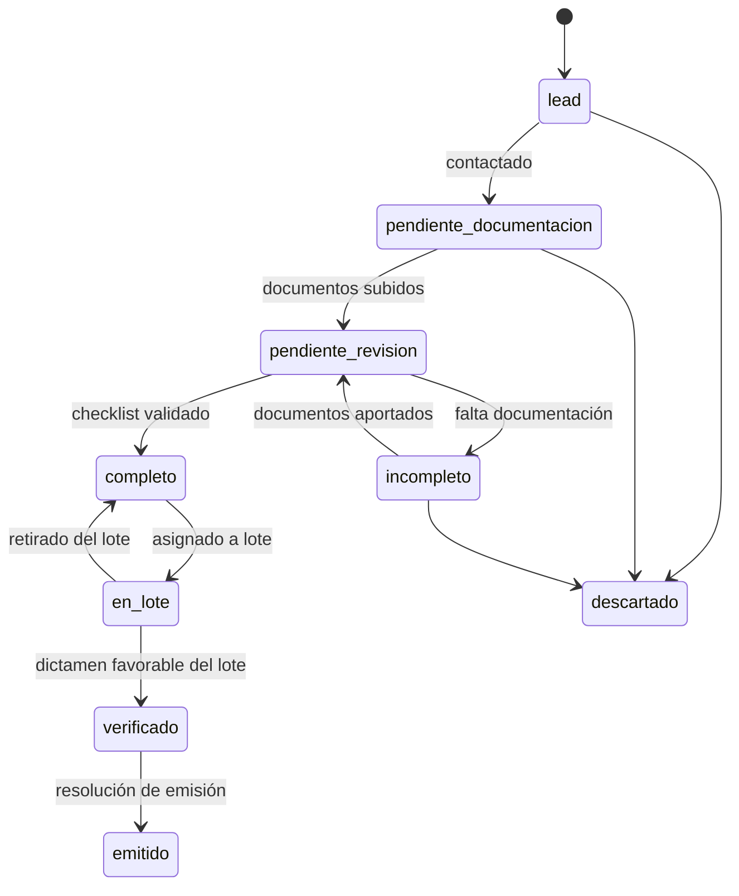
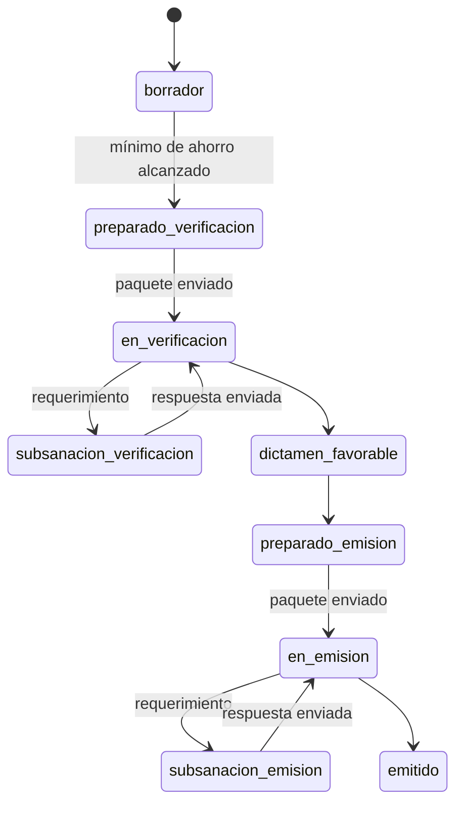
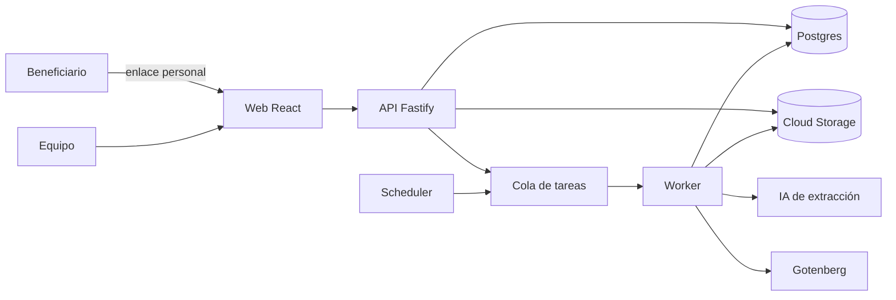

# Certia — Proyecto

## 1. Contexto

Los **Certificados de Ahorro Energético (CAE)** se regulan en el Real Decreto 36/2023. Cada CAE acredita 1 kWh de ahorro de energía final conseguido con una actuación de eficiencia energética. Las empresas con obligaciones de ahorro los compran, y quien genera el ahorro (o un intermediario que lo agrupa) los vende.

El primer cliente es un **facilitador** del sector que gestiona hoy, sobre todo, actuaciones de **vehículo eléctrico**, y quiere ampliar a actuaciones de proyecto (envolvente, aerotermia, solar, electrodomésticos…). El catálogo oficial tiene entre 70 y 80 fichas y crece cada año.

Flujo de negocio actual:

1. **Captación**: formularios web → lead → secuencia de emails → llamada.
2. **Revisión documental**: el beneficiario sube documentos; el equipo revisa hasta tener un **expediente completo**.
3. **Lotes**: expedientes completos de la misma comunidad autónoma y año se agrupan hasta superar el mínimo de ahorro exigido.
4. **Verificación**: el lote se envía a un verificador acreditado por ENAC; subsanaciones hasta obtener **dictamen favorable**.
5. **Emisión**: se envía al gestor autonómico; subsanaciones hasta la **resolución de emisión**.
6. **Venta, facturación y pago** a los beneficiarios.

## 2. Problema

- La información vive en decenas de hojas de Google Sheets, sincronizadas con una base de datos mediante unos 140 scripts.
- El equipo escribe el mismo dato en varios sitios (estado, prioridades, control de lotes, feedback diario, bonificaciones).
- La hoja central es lenta, se rompe y cualquiera puede borrar datos por error.
- Las fichas nuevas o sus nuevas versiones no están en la herramienta y se tramitan a mano.
- Las plantillas (acuerdo de cesión, declaración responsable) se editan manualmente para cada variante.
- Los datos sensibles (DNI, cuentas bancarias) no tienen una protección robusta.
- La persona que mantenía el sistema ya no está y no hay plan de mantenimiento.

## 3. Objetivos

Las cinco premisas del cliente guían todas las decisiones:

1. **Unificar** herramientas al máximo.
2. **Protección de datos** fuerte.
3. **Robustez.**
4. **Escribir en un solo sitio y una sola vez.**
5. **Mantenimiento** a medio y largo plazo.

Objetivo del MVP: **que los expedientes de vehículo eléctrico se gestionen de principio a fin en Certia, sin usar hojas de cálculo en la operativa diaria.**

## 4. Alcance

### Dentro del MVP

- Una ficha: **vehículo eléctrico**, versión anterior y vigente, con comparador.
- Leads, beneficiarios y expedientes con flujo de estados.
- Portal de subida de documentos para el beneficiario.
- Normalización de documentos (PDF, renombrado, compresión).
- Extracción de datos con IA y revisión humana.
- Cálculo de ahorro según la ficha.
- Generación de acuerdo de cesión y declaración responsable con cláusulas opcionales.
- Lotes: propuesta automática, paquete de verificación y de emisión.
- Subsanaciones como tareas.
- Semáforo de expedientes y lotes atascados, KPIs por persona.
- Roles, auditoría y cifrado de datos sensibles.
- Importación de los datos actuales.

### Fuera del MVP (fases siguientes)

- Pagos a beneficiarios y remesas SEPA (primera prioridad de la fase 2).
- Facturación de CAE y conexión contable o ERP.
- Otras fichas (motor preparado, pero sin configurar).
- Editor visual de fichas.
- WhatsApp y llamadas integradas.
- Portal para verificadores.
- Recordatorios automáticos a verificadores (el MVP ya detecta los atascos).
- Sustitución de la herramienta de email marketing.
- Multiempresa comercial (el modelo de datos ya lo contempla).

## 5. Usuarios y roles

| Rol | Qué hace |
|---|---|
| **Administrador** | Configuración, usuarios, acceso completo |
| **Dirección** | Paneles, KPIs y lectura de todo |
| **Gestión** | Relación con el beneficiario: leads, documentación, revisión, subsanaciones de cliente |
| **Verificación** | Lotes, verificadores, gestor autonómico, emisión |
| **Lectura** | Consulta sin edición |
| **Beneficiario** | Acceso externo, solo a su portal de subida mediante enlace personal |

Un usuario puede tener varios roles. Los datos bancarios y los documentos de identidad solo son visibles para los roles que los necesitan.

## 6. Flujos

### Expediente

### Lote

Las condiciones de cada transición (por ejemplo, "checklist validado") se definen en la ficha y las comprueba el motor de flujo.

## 7. Arquitectura

### Decisiones

| # | Decisión | Motivo |
|---|---|---|
| D1 | **Monolito modular** en Node.js y TypeScript, una imagen con modos `api` y `worker` | Rapidez de desarrollo y mantenimiento sencillo, sin la complejidad de microservicios |
| D2 | **Fichas como configuración** versionada (YAML en el repositorio para el MVP) | Escalar a cualquier tipo de actuación sin tocar el motor |
| D3 | **Las versiones de ficha publicadas son inmutables**; cada expediente queda anclado a una versión | Un cambio normativo no rompe expedientes existentes y permite el comparador |
| D4 | **Postgres como única fuente de verdad**; datos específicos de la ficha en JSONB validado | Elimina las hojas de cálculo como intermediarias |
| D5 | **Tabla de eventos** para cada cambio | Historial, auditoría, semáforo y KPIs sin doble escritura |
| D6 | **`core` sin dependencias de infraestructura**; integraciones detrás de `adapters` | Lógica de negocio testeable y portabilidad entre proveedores |
| D7 | **Google Cloud** (Cloud Run, Cloud SQL, Cloud Storage) en Madrid, dominio **certia-es.com** | El cliente ya usa Google Workspace; un solo proveedor y datos en España |
| D8 | **Login con Google** limitado al dominio de la empresa | Altas y bajas gestionadas desde Workspace, sin contraseñas propias |
| D9 | **Cifrado de DNI e IBAN a nivel de aplicación** con clave en Cloud KMS | Una copia de la base de datos no expone esos datos |
| D10 | **`organization_id` en todas las tablas** desde el primer día | Permite multiempresa sin migraciones futuras |

### Componentes

## 8. Modelo de datos (resumen)

El código, las tablas y las columnas están en inglés; los términos del dominio sin buena traducción (ficha, expediente, lote) se mantienen en español.

| Tabla | Contenido principal |
|---|---|
| `organizations` | Empresa usuaria |
| `users`, `user_roles` | Usuarios y roles |
| `contacts` | Beneficiarios (datos sensibles cifrados) |
| `leads` | Origen, canal, estado de contacto |
| `ficha_versions` | Código, versión, vigencia, hash de la definición |
| `expedientes` | Expediente: contacto, ficha y versión, estado, comunidad autónoma, año, `data` (JSONB), ahorro calculado, responsable |
| `documents` | Tipo, archivo, datos extraídos, confianza, estado de validación |
| `generated_documents` | Documentos generados, plantilla y opciones usadas |
| `lotes`, `lote_expedientes` | Agrupaciones, estado, verificador, totales |
| `tasks` | Subsanaciones y tareas: origen, responsable, prioridad, vencimiento |
| `events` | Quién, qué, cuándo y sobre qué entidad (solo se añaden registros) |
| `objectives` | Objetivos mensuales por usuario |

El esquema detallado vive en `packages/db`.

## 9. Plan de entregas

Supuesto: **2 desarrolladores, sprints de una semana, unas 8 semanas** hasta el piloto. Cada sprint termina con una demo en staging.

| Semana | Entrega |
|---|---|
| **1** | Repositorio, Docker local, CI, despliegue a staging, login con Google, roles, esquema base, eventos |
| **2** | Motor de fichas y cálculo, ficha de vehículo eléctrico v1 y v2 con casos de prueba, contactos y expedientes con flujo de estados |
| **3** | Documentos: portal de subida, normalización a PDF, compresión, checklist documental |
| **4** | Extracción con IA y pantalla de revisión (documento junto a datos), comparador de versiones de ficha |
| **5** | Generación de acuerdo de cesión y declaración responsable con cláusulas opcionales |
| **6** | Lotes: propuesta automática, paquetes de verificación y emisión con validación de nombres y tamaños |
| **7** | Tareas y subsanaciones, semáforo, KPIs por persona, vista "mis tareas" |
| **8** | Importación de datos actuales, cifrado y auditoría revisados, pruebas con usuarios, **piloto** en paralelo con las hojas actuales |

Después del piloto: 2 a 4 semanas de operativa en paralelo, ajustes y retirada de las hojas de cálculo para vehículo eléctrico.

### Para ir más rápido

- Si hay que recortar, se mueven a fase 2 en este orden: comparador de fichas (F-07), KPIs por persona (F-14), extracción con IA (F-05, sustituida temporalmente por entrada manual asistida).
- Lo que no se recorta nunca: fuente única de datos, flujo de estados, lotes y seguridad.

## 10. Criterios de éxito del MVP

- Ningún expediente de vehículo eléctrico se gestiona fuera de Certia.
- Cada cambio de estado se escribe una sola vez.
- Dirección ve atascos y KPIs sin que nadie actualice nada a mano.
- Montar y empaquetar un lote pasa de horas a minutos.
- Ningún paquete enviado a verificación o emisión se rechaza por nombres o tamaños de archivo.

## 11. Riesgos y supuestos

| Riesgo | Mitigación |
|---|---|
| Acceso incompleto al código y datos actuales | Prioridad de la semana 1; la importación parte de exportaciones de Sheets y base de datos |
| Reglas de negocio no documentadas | Vídeos de formación del cliente y sesiones cortas con el equipo de gestión y verificación |
| Cambios normativos durante el desarrollo | Versionado de fichas desde el inicio |
| Errores en la migración de datos | Importación idempotente, informe de diferencias y operativa en paralelo |
| Rechazo del equipo al cambio | Piloto con 2 o 3 usuarios clave antes de abrirlo a todos |
| Responsabilidad sobre el cálculo de ahorro | Casos de prueba por ficha y validación final del verificador |

## 12. Preguntas abiertas

- Volumen mensual de leads, expedientes y documentos por expediente.
- Detalle de los parámetros que cambian entre la versión anterior y la vigente de la ficha de vehículo eléctrico.
- Especificación oficial de nombres y formatos de archivo para verificación y emisión por comunidad autónoma.
- Plantillas actuales (acuerdo de cesión, declaración responsable, convenio) en formato editable.
- Lista de cláusulas opcionales y cuándo aplica cada una.
- Qué datos del sistema actual hay que importar y desde qué fecha.
- Quién será el responsable interno del producto en el lado del cliente.
- Modelo de mantenimiento y soporte tras la entrega.
