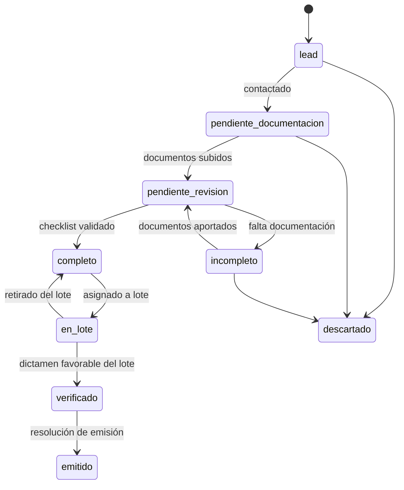
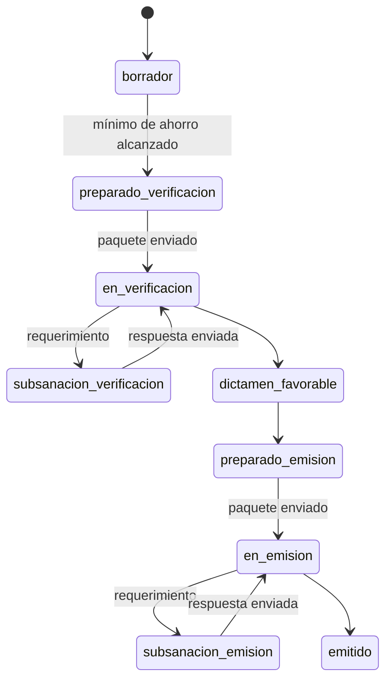
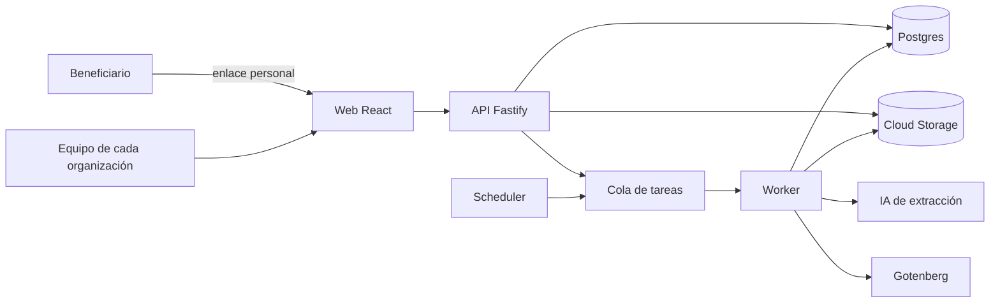

# Certia — Proyecto

## 1. Contexto

Los **Certificados de Ahorro Energético (CAE)** se regulan en el Real Decreto 36/2023. Cada CAE acredita 1 kWh de ahorro de energía final conseguido con una actuación de eficiencia energética. Las empresas con obligaciones de ahorro los compran, y quien genera el ahorro (o un intermediario que lo agrupa) los vende.

**Certia es un producto para las empresas que gestionan expedientes CAE**: facilitadores, sujetos delegados e instaladoras que agrupan actuaciones y las llevan hasta la emisión de los certificados. El catálogo oficial tiene entre 70 y 80 fichas, cada una con sus campos, fórmulas y documentos, y cambia con la normativa.

El flujo de trabajo es común en el sector:

1. **Captación**: formularios y canales → lead → seguimiento → contacto.
2. **Revisión documental**: el beneficiario aporta documentos; el equipo revisa hasta tener un **expediente completo**.
3. **Lotes**: expedientes completos de la misma comunidad autónoma y año se agrupan hasta superar el mínimo de ahorro exigido.
4. **Verificación**: el lote se envía a un verificador acreditado por ENAC; subsanaciones hasta obtener **dictamen favorable**.
5. **Emisión**: se envía al gestor autonómico; subsanaciones hasta la **resolución de emisión**.
6. **Venta, facturación y pago** a los beneficiarios.

**Fuentes del producto.** Certia se construye a partir de la normativa y documentación pública (Real Decreto 36/2023, catálogo de fichas del Ministerio, procedimientos de las comunidades autónomas), del conocimiento general del sector y de lo que aporten los socios de diseño con su autorización. Nunca a partir de información confidencial de terceros.

## 2. Problema

Lo habitual en el sector:

- La información vive en hojas de cálculo, carpetas compartidas y herramientas sueltas, conectadas a mano o con scripts frágiles.
- El equipo escribe el mismo dato en varios sitios: estado, prioridades, control de lotes, seguimiento diario.
- Cada cambio normativo de una ficha obliga a rehacer cálculos, plantillas y controles a mano.
- Las plantillas (acuerdo de cesión, declaración responsable) se editan manualmente para cada variante.
- Datos sensibles de beneficiarios (DNI, cuentas bancarias, domicilios) circulan sin una protección adecuada.
- Las herramientas hechas a medida dependen de una sola persona y nadie las mantiene cuando se va.

## 3. Principios del producto

1. **Una sola herramienta** para todo el flujo, de la captación a la emisión.
2. **Protección de datos** desde el diseño: cifrado, permisos por rol, auditoría y datos en la UE.
3. **Robustez**: cada cambio queda registrado y las fichas se prueban antes de publicarse.
4. **Escribir en un solo sitio y una sola vez.**
5. **Fichas como configuración**: una ficha nueva o un cambio normativo no requiere programar.
6. **Multiempresa**: cada organización ve solo sus datos y configura sus roles y plantillas.

Objetivo del MVP: **que una empresa del sector pueda gestionar de principio a fin sus expedientes de una ficha en Certia, sin hojas de cálculo en la operativa diaria**, validado con 2–3 socios de diseño.

## 4. Alcance

### Dentro del MVP

- Una ficha inicial completa (vehículo eléctrico, a confirmar con las entrevistas), con versión anterior y vigente y comparador.
- Varias organizaciones aisladas entre sí; alta de organizaciones por el equipo de Certia.
- Leads, beneficiarios y expedientes con flujo de estados.
- Portal de subida de documentos para el beneficiario.
- Normalización de documentos (PDF, renombrado, compresión).
- Extracción de datos con IA y revisión humana.
- Cálculo de ahorro según la ficha.
- Generación de acuerdo de cesión y declaración responsable con cláusulas opcionales, con plantillas propias de cada organización.
- Lotes: propuesta automática, paquete de verificación y de emisión.
- Subsanaciones como tareas.
- Semáforo de expedientes y lotes atascados, KPIs por persona.
- Roles, auditoría y cifrado de datos sensibles.
- Importación de expedientes desde hojas de cálculo.

### Fuera del MVP (fases siguientes)

- Más fichas, priorizadas por la demanda de los clientes.
- Alta de organizaciones en autoservicio y facturación de la suscripción.
- Pagos a beneficiarios y remesas SEPA.
- Facturación de CAE y conexión contable o ERP.
- Editor visual de fichas.
- WhatsApp y llamadas integradas.
- Portal para verificadores.
- Recordatorios automáticos a verificadores (el MVP ya detecta los atascos).

## 5. Usuarios y roles

Dentro de cada organización cliente:

| Rol | Qué hace |
|---|---|
| **Administrador** | Configuración de la organización, usuarios, plantillas, acceso completo |
| **Dirección** | Paneles, KPIs y lectura de todo |
| **Gestión** | Relación con el beneficiario: leads, documentación, revisión, subsanaciones del beneficiario |
| **Verificación** | Lotes, verificadores, gestor autonómico, emisión |
| **Lectura** | Consulta sin edición |
| **Beneficiario** | Acceso externo, solo a su portal de subida mediante enlace personal |

Un usuario puede tener varios roles. Los datos bancarios y los documentos de identidad solo son visibles para los roles que los necesitan. El equipo de Certia administra el catálogo de fichas común a todas las organizaciones.

## 6. Flujos

### Expediente

### Lote

Las condiciones de cada transición (por ejemplo, "checklist validado") se definen en la ficha y las comprueba el motor de flujo.

## 7. Arquitectura

### Decisiones

| # | Decisión | Motivo |
|---|---|---|
| D1 | **Monolito modular** en Node.js y TypeScript, una imagen con modos `api` y `worker` | Rapidez de desarrollo y mantenimiento sencillo, sin la complejidad de microservicios |
| D2 | **Fichas como configuración** versionada (YAML en el repositorio para el MVP) | Escalar a cualquier tipo de actuación sin tocar el motor |
| D3 | **Las versiones de ficha publicadas son inmutables**; cada expediente queda anclado a una versión | Un cambio normativo no rompe expedientes existentes y permite el comparador |
| D4 | **Postgres como única fuente de verdad**; datos específicos de la ficha en JSONB validado | Elimina las hojas de cálculo como intermediarias |
| D5 | **Tabla de eventos** para cada cambio | Historial, auditoría, semáforo y KPIs sin doble escritura |
| D6 | **`core` sin dependencias de infraestructura**; integraciones detrás de `adapters` | Lógica de negocio testeable y portabilidad entre proveedores |
| D7 | **Google Cloud** (Cloud Run, Cloud SQL, Cloud Storage) en Madrid, dominio **certia-es.com** | Servicios gestionados de bajo coste y datos de los clientes en España |
| D8 | **Login con cuentas corporativas** (Google y, después, Microsoft) limitado al dominio de cada organización | Altas y bajas gestionadas por cada cliente, sin contraseñas propias |
| D9 | **Cifrado de DNI e IBAN a nivel de aplicación** con clave en Cloud KMS | Una copia de la base de datos no expone esos datos |
| D10 | **`organization_id` en todas las tablas** y aislamiento comprobado en cada consulta | Varias organizaciones en la misma instalación sin que ninguna vea datos de otra |

### Componentes

## 8. Modelo de datos (resumen)

El código, las tablas y las columnas están en inglés; los términos del dominio sin buena traducción (ficha, expediente, lote) se mantienen en español.

| Tabla | Contenido principal |
|---|---|
| `organizations` | Empresa cliente |
| `users`, `user_roles` | Usuarios y roles |
| `contacts` | Beneficiarios (datos sensibles cifrados) |
| `leads` | Origen, canal, estado de contacto |
| `ficha_versions` | Código, versión, vigencia, hash de la definición |
| `expedientes` | Expediente: contacto, ficha y versión, estado, comunidad autónoma, año, `data` (JSONB), ahorro calculado, responsable |
| `documents` | Tipo, archivo, datos extraídos, confianza, estado de validación |
| `generated_documents` | Documentos generados, plantilla y opciones usadas |
| `lotes`, `lote_expedientes` | Agrupaciones, estado, verificador, totales |
| `tasks` | Subsanaciones y tareas: origen, responsable, prioridad, vencimiento |
| `events` | Quién, qué, cuándo y sobre qué entidad (solo se añaden registros) |
| `objectives` | Objetivos mensuales por usuario |

El esquema detallado vive en `packages/db`.

## 9. Plan de entregas

Supuesto: **un ingeniero a 30 horas por semana**, con una demo cada dos semanas en staging. En paralelo, la parte de negocio valida el producto con el mercado.

| Semanas | Producto | Validación con el mercado |
|---|---|---|
| **1–2** | Base: accesos, login, organizaciones, roles, despliegue | Entrevistas con 5–10 empresas del sector |
| **3–4** | Motor de fichas y expedientes | Elegir la ficha inicial y cerrar 2–3 socios de diseño |
| **5–7** | Portal del beneficiario, documentos y checklist | Recoger plantillas y requisitos de los socios de diseño |
| **8–9** | Acuerdos y declaraciones con plantillas por organización | Revisión de plantillas con los socios |
| **10–11** | Lotes y paquetes de verificación y emisión | Especificaciones de formato por comunidad autónoma |
| **12** | Subsanaciones y semáforo | — |
| **13–14** | Importación y **piloto** con los socios de diseño | Piloto en paralelo con sus herramientas actuales |
| **15–21** | IA de extracción, comparador de fichas y KPIs | Ajustes del piloto y primeras ventas |

Lo que no se aplaza nunca: fuente única de datos, aislamiento entre organizaciones, flujo de estados, lotes y seguridad.

## 10. Criterios de éxito del MVP

- 2–3 socios de diseño gestionan sus expedientes de la ficha inicial en Certia, sin hojas de cálculo.
- Cada cambio de estado se escribe una sola vez.
- Dirección ve atascos y KPIs sin que nadie actualice nada a mano.
- Montar y empaquetar un lote pasa de horas a minutos.
- Ningún paquete enviado a verificación o emisión se rechaza por nombres o tamaños de archivo.
- Al menos un socio de diseño acepta pasar a una suscripción de pago.

## 11. Riesgos y supuestos

| Riesgo | Mitigación |
|---|---|
| El problema o la ficha elegida no son los que más pagan en el mercado | Entrevistas antes de construir en profundidad; la ficha inicial se decide con esos datos |
| No conseguir socios de diseño | Red de contactos del socio de negocio; condiciones preferentes para los primeros clientes |
| Cada empresa trabaja de forma distinta | Separar el proceso común (producto) de las preferencias de cada empresa (configuración) |
| Cambios normativos durante el desarrollo | Versionado de fichas desde el inicio |
| Errores en la importación de datos | Importación idempotente, informe de diferencias y operativa en paralelo |
| Uso de información confidencial de terceros | Construir desde fuentes públicas; los datos de socios solo con autorización escrita y anonimizados |
| Responsabilidad sobre el cálculo de ahorro | Casos de prueba por ficha y validación final del verificador |
| Dedicación parcial del equipo | Alcance por módulos y prioridades fijas; lo esencial primero |

## 12. Preguntas abiertas

- Qué tipo de empresa compra primero: facilitadores, sujetos delegados o instaladoras.
- Qué fichas concentran más volumen de expedientes en el mercado.
- Cuánto pagaría una empresa por mes, y si prefiere precio por usuario, por organización o por volumen.
- Especificación oficial de nombres y formatos de archivo para verificación y emisión por comunidad autónoma.
- Qué cláusulas de los documentos generados son comunes y cuáles propias de cada empresa.
- Qué herramientas usan hoy los clientes potenciales y desde dónde habría que importar.
